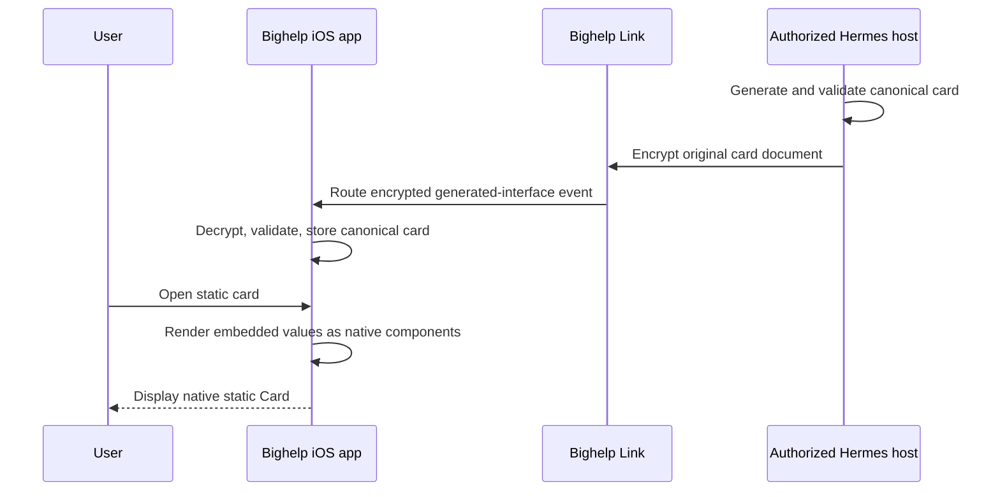

# bighelp Cards

bighelp Cards are declarative, display-only interfaces generated by an agent and
rendered as native SwiftUI. Build 3 ships static Cards only: every displayed
value is embedded in the payload and `data_sources` must be empty. The card is
data: it cannot contain Swift, JavaScript, HTML, a WebView, downloaded code,
arbitrary actions, or a request body. Live Card data refresh is reserved for a
later release.

The Hermes plugin validates and canonicalizes the original document, adds its
identity fields, and sends it once through the encrypted conversation path. The
iOS app validates it again before rendering. Neither side fetches Card data in
build 3.

## Complete wire example

The following is a complete `loopdy.card` version 1 document after the renderer
has added `content_hash`, `card_id`, `created_at`, and `origin`. This object is
carried in the existing generated-interface event or event detail.

```json
{
  "schema": "loopdy.card",
  "version": 1,
  "title": "Build health",
  "spoken_summary": "All twelve checks passed and the build is ready for review.",
  "importance": "important",
  "data_sources": [],
  "root": "card",
  "elements": {
    "card": {
      "type": "card",
      "props": {
        "title": "Build health",
        "subtitle": "Local verification"
      },
      "children": ["metrics", "status"]
    },
    "metrics": {
      "type": "hstack",
      "props": {
        "spacing": "medium",
        "alignment": "leading"
      },
      "children": ["passed", "failed"]
    },
    "passed": {
      "type": "metric",
      "props": {
        "label": "Passed",
        "value": { "literal": 12 },
        "format": { "style": "integer" },
        "semantic": "positive"
      },
      "children": []
    },
    "failed": {
      "type": "metric",
      "props": { "label": "Failed", "value": { "literal": 0 }, "format": { "style": "integer" }, "semantic": "neutral" },
      "children": []
    },
    "status": {
      "type": "badge",
      "props": { "value": { "literal": "Ready" }, "semantic": "positive" },
      "children": []
    }
  },
  "content_hash": "ce63fd5994bc8b091720c4c7dd4d5ecbb6344e651a6d9044143ca5fc13643d87",
  "card_id": "ce63fd5994bc8b091720c4c7dd4d5ecb",
  "created_at": "2026-09-02T12:00:00Z",
  "origin": "live"
}
```

The hash is SHA-256 over the canonical input document before the four
renderer-owned fields are added. `card_id` is the first 32 lowercase hexadecimal
characters of that hash. `importance` and `valid_until` are optional root fields
used for generic presentation and ranking; they do not grant new capabilities.

The portable input contract is
[`loopdy-card-v1.schema.json`](https://github.com/promptclickrun/bighelp-plugin/blob/main/spec/loopdy-card-v1.schema.json).
The plugin validator and the iOS validator remain authoritative for limits and
cross-field rules that JSON Schema alone cannot express.

## Finite component catalog

Version 1 recognizes exactly the following component types. Every element has
`type`, `props`, and `children`; unknown types, props, and enum values fail
validation.

| Type | Purpose | Allowed props | Children |
|---|---|---|---|
| `card` | Titled native container | `title`, `subtitle` | Up to 20 |
| `vstack` | Vertical layout | `spacing`, `alignment` | Up to 20 |
| `hstack` | Horizontal layout | `spacing`, `alignment` | Up to 20 |
| `grid` | Two- or three-column layout | `columns`, `spacing`, `alignment` | Up to 20 |
| `text` | Text value | `value`, `format`, `typography`, `color`, `alignment`, `line_limit` | None |
| `metric` | Label and prominent value with optional trend | `label`, `value`, `format`, `trend`, `trend_format`, `semantic` | None |
| `badge` | Short semantic status | `value`, `semantic` | None |
| `progress` | Value bounded by a declared maximum | `label`, `value`, `maximum`, `format`, `semantic` | None |
| `chart` | Line, area, or bar series | `kind`, `description`, `series` | None |
| `table` | Bounded columns and rows | `columns`, `rows` | None |
| `list` | Repeated template over a source array | `items`, `empty_text`, `shows_dividers` | Exactly one template child |
| `divider` | Native divider | `semantic` | None |
| `spacer` | Token-based spacing | `size` | None |
| `image` | Bundled SF Symbol or app asset | `name`, `accessibility_label`, `semantic`, `scale` | None |

Colors are limited to `primary`, `secondary`, `positive`, `warning`, `negative`,
`accent`, and `neutral`. Spacing is limited to `none`, `xsmall`, `small`,
`medium`, `large`, and `xlarge`. Typography is limited to `caption`, `body`,
`callout`, `headline`, `title`, and `large_title`. The document cannot provide
RGB values, font names, font sizes, frames, coordinates, blur radii, arbitrary
SF Symbol names, or SwiftUI modifiers. Version 1 images are bundled symbols or
assets only; remote image decoding is not supported.

## Object components

Plugin feature `native-card-objects-v1` adds three components that show one real
thing the person can act on: a person, a place, or music. They follow Bots
mode's look: one clean row with a round picture, a title, one quiet line, and a
few round buttons. They are still data. Each button is one fixed native action
the app chooses from the props; a card can't name a URL scheme, a selector or
code.

| Type | Purpose | Allowed props | Children |
|---|---|---|---|
| `contact` | A person, with Call, Message, Email and Contacts | `name`, `subtitle`, `phones`, `emails`, `address`, `contact_id` | None |
| `place` | A spot on a map, with Directions and Maps | `name`, `subtitle`, `address`, `latitude`, `longitude`, `span_meters` | None |
| `music` | A song, album, playlist or artist, with Play and Music | `kind`, `title`, `artist`, `music_id`, `source`, `url` | None |

- `contact`: `name` (required, 1–200). `subtitle` (≤ 200, like a job or
  company). `phones` and `emails` (≤ 5 each) are `{label, value}` with `label`
  ≤ 40 and `value` ≤ 200; a phone keeps only digits, spaces and `+ ( ) - .`,
  an email must look like one. `address` is `{street, city, region,
  postal_code, country}`, each ≤ 100. `contact_id` (≤ 512) is the id from
  `iphone_contacts`: the button opens that person in Contacts when this phone
  has them, else offers Add to Contacts with the card's fields.
  Buttons: Call and Message for the first phone, Email for the first email,
  Directions when there's an address, and Contacts.
- `place`: `name` (required, 1–200), `latitude` (−90–90) and `longitude`
  (−180–180) (required), `subtitle` (≤ 200, like "Coffee · Open until 6 PM"),
  `address` (≤ 300), `span_meters` (200–50,000, default 1,000). The app draws a
  still map picture with a pin (MapKit's snapshotter, kept by coordinate), never
  a live map in the chat. Buttons: Directions and Open in Maps.
- `music`: `kind` (required: `song`, `album`, `playlist` or `artist`), `title`
  (required, 1–200), `artist` (≤ 200), `music_id` and `source` (`catalog` or
  `library`) from `iphone_music`, `url` (≤ 500, only `https://music.apple.com/…`).
  The artwork leads the object. It comes from MusicKit by id while Music is on
  in Device access and Apple Music is allowed (catalog item, or library item
  for library ids like `i.…`); otherwise from Apple's public lookup
  (`itunes.apple.com/lookup`) by the store number in `url` or a numeric
  `music_id`, else its search by title and artist, kept only when the answer
  names the same title and artist. Pictures are kept in memory and in Caches
  by item (`BighelpCardMusicLookup.cacheKey`); until one comes, and when none
  does, the object shows the kind's symbol. Play plays it through the Music app
  when Music is on, else opens it in Music; Open in Music opens `url` or the id.
- Object props are plain JSON values, never `{ "literal": … }` or other
  bindings, and objects take no children. A phone's or email's `label` may be
  left out; an `address` with every part empty reads as no address.
- What the app does (`BighelpCardObjects`, `BighelpCardObjectViews`):
  - Contact: the saved person's photo when the card has a `contact_id` and
    Contacts access already lets bighelp read it, else a round initials
    picture. Call and Message open `tel:` and `sms:`
    with the first phone's digits, Email opens `mailto:`, Directions opens
    Maps' driving directions to the written address. The Contacts button reads
    Open in Contacts when the card has a `contact_id` and Contacts access
    already lets bighelp read it, else Add to Contacts (Contacts' own new-contact
    screen, filled in from the card). A card never asks for Contacts access.
  - Place: the map picture is a button that opens Maps too. Directions and
    Open in Maps hand the spot to Maps (`MKMapItem`). Pictures are kept by
    coordinate, span, size, scale and light or dark (`BighelpCardMapSnapshots`).
  - Music: Open in Music opens `url`, else the catalog item's page
    (`https://music.apple.com/<kind>/<music_id>`), else a search in Music for
    the title and artist (library ids have no public page). On the Mac, Play
    opens Music.
  - Every button is round, at least 44 points (56 on Vision Pro), with a
    VoiceOver name; on the Mac a right-click lists the same actions.
- A card may hold several objects (a `vstack` of three places, say), up to the
  card's element limit.
- Older apps reject unknown types ("Invalid or unsupported card"), so the
  plugin accepts these only in a chat whose app said it draws them: before each
  turn the app's `people/speaking` note carries `renders: ["contact", "place",
  "music"]` when `/native/context` lists `native-card-objects-v1`. A card with
  an object in any other chat is refused with a note that tells the agent to
  use the basic components.
  The app reads the feature from the context it loaded when it connected, so
  the note costs no extra request; without the feature the note stays exactly
  as before, because older plugins refuse fields they don't know.
- `-use-demo-fixtures -test-object-cards` opens a chat with one card holding a
  made-up person, place and song (`BighelpCardDemoFixtures.objects`).

## Weather backgrounds

A `card` element may carry an animated weather background beside its `props`:

```json
"card": {
  "type": "card",
  "props": { "title": "Sample Bay", "subtitle": "Heavy rain" },
  "background": { "scene": "rain", "intensity": "heavy", "time_of_day": "night" },
  "children": ["now"]
}
```

`scene` is `none`, `clear`, `partly_cloudy`, `overcast`, `rain`, `thunderstorm`,
`snow`, `fog` or `wind`; `intensity` is `light`, `moderate` (default) or
`heavy`; `time_of_day` is `day` (default), `dusk` or `night`. The plugin rejects
a background on any other element, inside `props`, or with extra keys.

It sits beside `props` so app builds from before it, which ignore element keys
they don't know but reject unknown props, still show the card, just without
the weather. No plugin feature flag is needed.

The app (`CardBackground`, `CardBackgroundView`) reads only the root card's
background, and parses it leniently:

- No background, `scene: none`, or a background it can't read: the card's usual
  surface, drawn exactly as before.
- An unknown scene: a still, neutral gradient for the time of day. Unknown
  intensity or time of day: `moderate` or `day`. Each unknown value is logged
  once per launch. Extra keys are ignored.
- Otherwise the scene's gradient, a scrim, and the scene's animation on top,
  clipped to the card. The card's content is drawn in the dark color scheme
  and never knows the background is there.
- The scrim is set per scene and time so primary and secondary text keep 4.5:1
  over the brightest sky, with every glow, cloud, mist and lightning flash at
  full strength (`CardBackgroundTests`). Rain, snowflakes, stars and gusts are a
  few points wide; even right behind a letter, primary text keeps 4.5:1.
- The animation is one `Canvas` under a `TimelineView` (30 or 24 frames a
  second), with particle counts capped by intensity (96 at most). It runs only
  while the card is on screen, the app is in front, and Reduce Motion and Low
  Power Mode are off. Otherwise, and in Copy as Image, the card shows its still
  gradient.
- `-use-demo-fixtures -test-weather-cards` opens a chat with one card per
  scene; `-test-weather-cards-plain` shows the same cards without backgrounds.

## Bindings, expressions, and formatting

A component value in build 3 uses the literal binding form:

```json
{ "literal": "Open" }
```

Source bindings, JSON Pointer resolution, and expressions are reserved for a
later live-data release. They are not valid in build-3 delivered Cards.

The only format styles are `text`, `integer`, `number`, `currency`, `percent`,
`date`, `time`, and `relative_date`. The app owns locale-aware formatting.

## Build-3 delivery sequence



There is no Card network request, polling loop, background refresh, or catch-up
loop in build 3. The canonical transcript document, its hash, and its card ID
remain unchanged.

## Live-data policy

Live data is unavailable in build 3. The plugin schema permits zero data
sources, the plugin validator rejects nonempty `data_sources`, the iOS envelope
validator rejects them again, and the production data client fails closed.
Network-policy and source-binding code retained for development is not a shipped
capability and must not be described to agents or users as active.

The main contract limits are:

- 64 KiB per encoded card document
- Zero data sources, 80 elements, tree depth 12, and 20 children per container
- Eight table columns and 50 rows
- Six chart series and 120 points per series
- 50 rendered list items


## Trust boundaries and privacy

| Boundary | Receives or controls | Does not receive or control |
|---|---|---|
| Hermes agent and plugin | User intent, embedded Card values, canonicalization, validation, content hash | Device credentials or executable Card code |
| bighelp Link | Encrypted original Card event and routing metadata | Decrypted Card content under the documented Link assumptions |
| bighelp iOS app | Decrypted Card, embedded values, native rendering | Executable code supplied by a Card or live Card source traffic |
| Third-party Card source host | Nothing in build 3 | Device IP, Card values, account keys, credentials, or transcript |
| bighelp notification infrastructure | No Card refresh request or response | Decrypted Card content or live source traffic |
| Template catalog and stores | Reviewed template data, metadata, integrity values, parameters, and install state | Native executable extensions or automatic permission expansion |

Build 3 makes no third-party Card request, so opening a Card does not disclose a
device IP address, request URL, timing, or query to a Card source host. Embedded
values still travel through the ordinary encrypted conversation path and remain
subject to the documented endpoint and provider trust boundaries.

## Visible states and failures

Static Cards render their embedded values without freshness or polling state.
`Invalid card element` or `Unsupported card element` replaces malformed or
unknown presentation content with an error label rather than executing it.

A document that fails envelope or card validation is not rendered as a bighelp
Card. Unknown versions, unknown components or props, nonempty data sources,
broken references, cycles, unreachable elements, duplicate IDs, bad hashes, and
limit violations fail closed. Legacy generated interfaces continue through
their existing renderer.

## Template lifecycle

A template bundle is declarative data with `id`, `version`, `name`, `summary`,
`author`, `license`, `minimum_card_version`, `parameters_schema`, `document`, and
`sha256`.

1. A catalog detail view shows the author, license, version, and requested
   component types before installation.
2. The app verifies catalog and bundle integrity, card-version support, the
   embedded card, and parameter schema before an atomic install. A failed update
   leaves the prior version intact; downgrades and hash mismatches are rejected.
3. Installing sends the template to the host through the plugin's native route
   `cards/templates/install` (feature `native-card-templates-v1`). Listing and
   removal use `cards/templates/list` and `cards/templates/remove`.
4. The plugin stores templates per profile and exposes generic search, detail,
   and render tools. Agents can also save their own layouts with
   `bighelp_save_ui_template` (origin `saved`, private to the profile), which
   search and render treat like installed ones. Template rendering still ends at the same
   `bighelp_render_card` validation boundary (named `loopdy_render_card` before
   plugin 2.20.0).
5. Parameters can replace declared literal slots only. They cannot replace a
   component type, element ID, binding, operation, or renderer-owned field.
6. Removing a template deletes it from the host. It
   does not rewrite cards already stored in transcripts.

Templates never install native code or add new component capabilities. No
production catalog URL is configured in this repository. Public catalog
publication requires a separately reviewed catalog repository, governance,
signing-key custody, and an explicit open-source license.

## Compatibility and non-goals

`loopdy.card` version 1 is a new schema alongside `loopdy.generative_ui`
versions 1 and 2. Existing generated cards and forms remain on the legacy
renderer. bighelp Cards do not reinterpret or silently upgrade those envelopes,
and version 1 remains display-only. The version 2 form and selection cards
take input: when the user sends a form or taps a selection's button, the app
sends the answer to the agent as the user's next message (`CardReplyText`,
through `ChatModel.sendCardReply`), steering a running turn like Send. It
leaves the composer's draft alone, and the card remembers what it sent. A
selection whose text starts with "/" is a command, so it goes into the
composer for the user to send.

Version 1 is not:

- A programmable runtime, web-rendering surface, or downloaded extension model.
- An interaction or form-submission protocol.
- An authenticated API client or a place to carry credentials and secrets.
- A streaming, polling, or background-refresh protocol.
- A remote-image pipeline. Images are limited to the allowlisted bundled symbols
  and assets.

- A commitment to a public catalog endpoint. This repository configures none.
- An API-compatibility layer for any related generative-interface project.

## Design credit

bighelp Cards credits Sameer Gupta's
[Generative UI DSL](https://github.com/sameergdogg/generative-ui) as an influence
on the constrained JSON-tree and fixed native component-catalog approach.
[Google A2UI](https://github.com/google/A2UI) and
[`json-render`](https://json-render.dev/) are related designs only. bighelp does
not claim adoption, endorsement, API compatibility, or copied code from any of
these projects.
