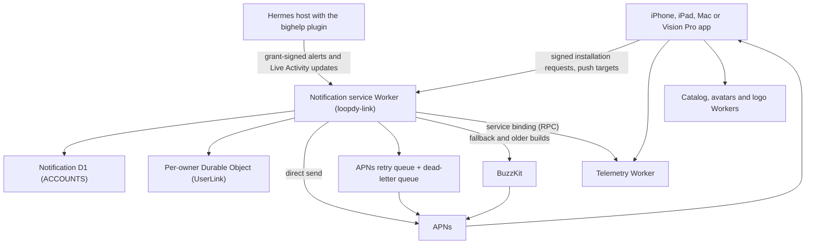

# Cloudflare infrastructure

This page describes bighelp's Cloudflare services as their source and Wrangler configs in `services/` define them.
It omits non-public production identifiers, private routes, database and namespace identifiers, anti-abuse
thresholds, exact retention intervals and secrets. The public service hostnames and app identifiers are already
visible in the app and in this repo.

Chat never goes through Cloudflare. The app talks straight to the person's Hermes host over native Hermes (REST
sign-in, the WebSocket JSON-RPC gateway and the plugin's routes under `/api/plugins/loopdy/native/…`; see
[Native transport](NATIVE_TRANSPORT.md)). The Cloudflare services are optional extras: notifications and Live
Activities, the template catalog, avatars, provider logos and usage numbers. If they are down, chat still works.
Agents, sessions, projects, scheduled tasks and workspace management use the host's own interfaces and add no
cloud service.

The retired bighelp account and its Link transport (pairing, and encrypted frames relayed between the phone and
a paired host) are gone from the app. See [Retired services](#retired-services).

## 1. The Workers

`services/` holds five Workers with a production config, plus the recovered source of an older relay:

| Folder | Worker | Hostname | What it binds |
|---|---|---|---|
| `services/link` | `loopdy-link` | `link.loopdy.app` | D1 `ACCOUNTS` and `MARKETPLACE_RETIREMENT`, Durable Object `USER_LINKS`, queue `APNS_RETRY`, service `TELEMETRY` |
| `services/telemetry` | `bighelp-telemetry` | `telemetry.bighelp.app` | two Rate Limiting bindings, no storage |
| `services/catalog` | `bighelp-catalog` | `catalog.bighelp.app` | D1 `DB`, static assets `REVIEWER_ASSETS`, a daily cron |
| `services/avatars` | `bighelp-avatars` | `avatars.bighelp.app` | static assets `ASSETS` (the Worker runs first) |
| `services/provider-logos` | `loopdy-provider-logos` | `logos.loopdy.app` | static assets only, no script |
| `services/relay` | (recovery only) | none | none: `wrangler.recovery.jsonc` is a local check that must never be deployed |

None of them binds KV or R2. Every Worker has `workers_dev` and preview URLs turned off. `services/link`,
`services/catalog` and `services/telemetry` also have a `wrangler.test.jsonc` for local tests, which must never be
deployed.

## 2. Logical topology

## 3. Notification service Worker (`services/link`)

The Worker kept its first name, `loopdy-link`, and its hostname, `link.loopdy.app`: installed phones and plugins
already use them. Today it is the notification service. It is responsible for:

- Notification installations: each phone registers its own signing key (`/v1/notifications/bootstrap`,
  `/v1/notifications/installations/current`), and can revoke it.
- Host grants: a Hermes host enrolls for one agent and sends alerts and Live Activity updates under that grant
  (`/v1/notifications/host-grants/…`).
- Push targets: the phone's APNs token for alerts and its Live Activity tokens (`/v1/notifications/push-target`,
  `/v1/notifications/live-activity-target`). The Worker encrypts the tokens at rest with
  `PUSH_TOKEN_KEY`.
- Agent avatars for alerts (`/v1/notifications/buzzkit/assets`).
- Delivery to APNs, directly or through BuzzKit (below).

It does not run agents or store readable chats.

### Bindings

- **D1 `ACCOUNTS`** (`loopdy-link-accounts`, `migrations/`): notification installations, grants, revocation
  records and push targets. Migrations `0001` to `0004` are the retired account and pairing tables.
- **D1 `MARKETPLACE_RETIREMENT`** (`loopdy-marketplace`, `marketplace-migrations/`): the old marketplace's
  tables are dropped. Only a receipt is left, which the Worker checks before it deletes an old account.
- **Durable Object `USER_LINKS`** (class `UserLink`, SQLite storage): one instance per owner. It holds that
  owner's notification state, such as Live Activity rows and alert avatars, and the retired Link frame queue.
- **Queue `APNS_RETRY`** (`loopdy-link-apns-retry`, dead-letter queue `loopdy-link-apns-retry-dlq`): the Worker
  produces to it and consumes it. Pushes APNs could not take at once wait there.
- **Service `TELEMETRY`**: the telemetry Worker's `TelemetryIngest` entrypoint. Without it the Worker still works
  and sends no events.

Workers Logs are on and sampled. Invocation logs are off, because a request URL can carry a grant ID. The code logs
fixed codes only.

### Direct APNs and BuzzKit

The Worker can send a push straight to APNs for installations whose app registered a push target with it.
Transient APNs failures go to the retry queue. A push that cannot be sent directly falls back to BuzzKit, which is
also the route for older app builds. `DIRECT_APNS` (`off`, `shadow` or `on`) controls direct sends, and
`APNS_ENVIRONMENTS` says which APNs environments get them. The APNs secrets are `APNS_KEY_P8`, `APNS_KEY_ID`,
`APNS_TEAM_ID` and `PUSH_TOKEN_KEY`. BuzzKit has its own secrets. See [Direct APNs relay](DIRECT_APNS_RELAY.md) for
the routes, payloads and rollout.

### Alert content and Live Activities

Current plugins seal each alert's title, text and avatar for the one enrolled phone (alert version 3). The Worker
and BuzzKit see only a neutral placeholder, and the phone opens the sealed content. For older plugins, the Worker
still accepts the earlier alert format, which carries readable title and text.

Live Activity updates carry a reduced, generic progress state for the Lock Screen: a phase, a time, a count of
helpers and the latest tool. They must not contain prompts, tool inputs, unrestricted model output, credentials or
private attachments. Chat titles and agent names stay on the phone. See
[Live Activity groups](LIVE_ACTIVITY_GROUPS.md).

## 4. What Cloudflare can and cannot see

### Cloudflare can process

- Network metadata that comes with any HTTPS service, and connection timing
- Opaque installation, grant, delivery and activity identifiers
- Public keys and authorization epochs
- Encrypted push tokens and sealed alert payloads, and their sizes
- Readable alert title and text from older plugins that do not seal alerts
- Generic Live Activity progress state
- Delivery status and aggregate counters

### Cannot see

- Chats, prompts, replies, attachments or voice: these go straight between the app and the host
- The content of sealed alerts
- Device signing private keys and notification recipient private keys

This does not make the system anonymous. Infrastructure providers can still see network and routing metadata, and
the Hermes host receives plaintext because it does the work.

## 5. Storage statement

bighelp's Cloudflare deployment does **not** contain a database of readable sessions, messages or transcripts.
The app may cache readable session state on the device. The Hermes host keeps sessions according to its own
configuration.

A phone can revoke its notification installation. The Worker then revokes that installation's grants and deletes
its push targets and its BuzzKit subscriber. Infrastructure backups and provider recovery systems can still outlive logical deletion according to
their configured policies.

## 6. Operational safety

Production operations should preserve these invariants:

- Never log plaintext alert content, credentials, push tokens or grant IDs.
- Keep all public traffic on TLS.
- Restrict service bindings to the minimum required services.
- Keep secrets in Cloudflare secret bindings, not in source or plain-text variables.
- Preserve replay protection, bounded parsing and authorization-epoch checks.
- Treat D1 migrations and Durable Object migrations as security-sensitive changes. `wrangler deploy` does not
  apply D1 migrations: apply and verify them first (see `services/link/SOURCE.md`).
- Treat host-key enrollment and rotation for sealed alerts as part of the notification service trust boundary.
- Test revocation from both active and offline states.
- Review privacy disclosures whenever a new durable field or storage product is introduced.

## 7. Reproducibility

This repo includes each Worker's source, its D1 migrations, its queue and Durable Object configuration, and its
tests (run from the Worker's folder). The
production `wrangler.jsonc` files are checked in. Secrets are set with `wrangler secret put` and stay out of
source. Some deploys also need a private config kept outside the repo, for example the catalog's reviewer
hostname (see `services/catalog/README.md`). Only the maintainer deploys these services.

Do not publish API tokens, APNs credentials, signing keys, production hostnames not already meant to be public,
or live operational thresholds.

## Telemetry Worker

The `bighelp-telemetry` Worker (`services/telemetry`) is a separate Worker at `telemetry.bighelp.app`. It accepts
batches from the app, the notification extension and the Hermes plugin. The notification service reaches it over a
service binding that calls the `TelemetryIngest` entrypoint.

- **It holds no storage.** There is no D1, KV, R2, queue or Durable Object. It checks each batch against an
  allowlist (`contracts/telemetry-v1.json`), applies two Workers Rate Limiting bindings (per ID, and per network by a
  keyed hash of the client address), and forwards accepted events to Azure Application Insights in the background.
- **Secrets:** `APPINSIGHTS_CONNECTION_STRING` and `IP_HASH_KEY`. Only this Worker holds the Azure key.
- **Privacy:** the client address is never stored, logged or forwarded. Logs hold fixed codes only, with sampling.
  The Worker adds no CORS headers, because only native clients call it.
- **Failure:** if Azure is down or the connection string is missing, the Worker still answers `202` and drops the
  events. A telemetry outage never affects pushes.

See [Telemetry](TELEMETRY.md) for what is collected and how to turn it off.

## Retired services

- **Link transport and the bighelp account.** The notification service's source still has the old passkey account,
  pairing, device and `/v1/socket` routes and the Link frame queue in its Durable Object, but no current app build
  uses them. The app removes old Link keys and settings at launch (`BighelpLinkAccountRetirement`). See
  [Legacy Link recipient overflow policy](LINK_RETENTION.md) for the old frame limits.
- **Notification relay.** `services/relay` is a byte-exact recovery of an older notification relay Worker, kept
  for reference and checks (`services/relay/README.md`). It has no production config or live bindings in this repo.
  The notification service has no binding to it, and the plugin no longer sends to a relay.
- **Wiki.** The Wiki family (`wiki.connect` and the other `wiki.*` operations) ran over the Link transport and
  later the plugin's routes. The plugin no longer serves them. See [contracts/wiki-v1.md](../contracts/wiki-v1.md).
- **Marketplace.** Its D1 tables are dropped (see the `MARKETPLACE_RETIREMENT` binding above).
