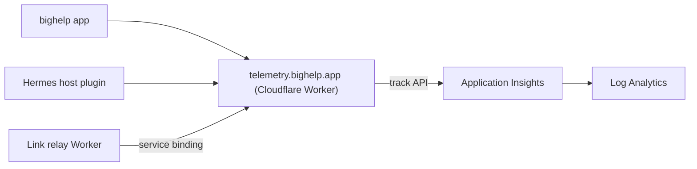

# Telemetry

bighelp sends a small amount of usage and performance data so the maintainer can fix slow pushes, crashes and hangs.
It is on by default and you can turn it off. This page lists what is sent, what is not, and how to run the service.

The exact list is one file: [`contracts/telemetry-v1.json`](../contracts/telemetry-v1.json). The Worker that checks
every batch enforces it from `services/telemetry/src/schema.ts`, and a test fails if the two differ. Anything not in
the file is dropped at the edge.

## What is collected

- **The app** sends events such as `app.opened`, `app.backgrounded`, `session.ended`, `feature.used` (from a fixed
  list), launch time, time to first token, reconnects, hangs and crashes. Hangs and crashes come from MetricKit and
  carry only a type, a signal, an exception code and unsymbolicated frames (a binary UUID, an offset and a binary
  name).
- **The notification extension** records, for each push, how late it arrived. The app sends these as
  `notification.received`.
- **A Hermes host with the bighelp plugin** sends `host.started`, `turn.completed`, `tool.completed`,
  `alert.queued`, `alert.sent` and `error`. They carry durations, counts, outcomes, the provider and model ID, and
  the plugin and Hermes versions. Tool names are sent only for built-in Hermes tools and `bighelp_*` tools. Other
  tools report `mcp` or `custom`.
- **The Link relay** reports `push.sent`, `push.token_invalid`, `push.retry`, `push.dlq`, `push.fallback_buzzkit` and
  `push.shadow`: the event type, a result code, timings and counts.

Each batch also names a random ID: an install ID the app keeps in the Keychain, or a telemetry ID the host keeps in
its own plugin data. Neither is derived from an account, an Apple ID or the host's notification key.

## What is never collected

Message text, prompts, replies, tool arguments or output, file names or paths, card contents, push tokens, names,
emails, IP addresses, host URLs, profile names, chat or session IDs, and event IDs.

How this is enforced:
- **No free text.** Every value is a number in a range, a word from a fixed list, or a short string that must match
  a strict pattern. A value that does not fit is dropped.
- **Pattern-checked identifiers are not fixed lists.** `provider`, `model`, `tool`, `code` (and the `reason`,
  `result` and `stage` values, which use the same pattern) and `hermesVersion` are short identifiers that must match
  a strict pattern: at most 64 characters of letters, digits and a few separators. The Worker can't prove they come
  from a fixed list, only that they are short and shaped like an identifier. The plugin maps them to fixed values
  before sending (for example `custom` for an unknown model, `mcp` or `custom` for a tool that isn't built in). The
  Worker is the second check, not the first.
- **Unknown names are dropped.** An unknown event name or key never reaches storage.
- **No address.** The Worker uses the client address only to make a keyed hash for rate limiting. It does not store,
  log or forward the address, and it sends Azure `0.0.0.0` in the location field.
- **Only the Worker holds the Azure key.** The app and the plugin hold no Azure credential.

## Where it goes and how long it stays

The Worker checks each batch, then forwards the accepted events to Azure Application Insights, which stores them in a
Log Analytics workspace in the Central US region. Both keep data for 90 days. The workspace has a daily ingestion cap.

The Worker keeps nothing. It logs fixed codes only, with sampling.

## Abuse limits

The Worker allows 60 batches a minute for one ID and 600 for one network (the full address for IPv4, the /64 prefix
for IPv6), and answers 429 with `Retry-After: 60`. If the Worker can't make a network key, all senders share one
key, so the limit still holds. These limits slow a casual sender, not a determined one. The hard backstop is the
workspace's 1 GB daily ingestion cap. Once it is reached, Azure stops storing data until the next day. For a flood,
add a Cloudflare WAF rate-limiting rule on `telemetry.bighelp.app/v1/batch` (optional, no code change). Alert rules
that read public events can be forged; see the Azure README.

## How to turn it off

- **App:** Settings > Privacy > "Share usage and diagnostics". When it is off, the app sends nothing, deletes its
  install ID, and tells each connected host to stop too. Turning it back on makes a new install ID.
- **Host plugin**, any one of these:
  - `hermes bighelp telemetry off` (and `on`, `status`)
  - the environment setting `BIGHELP_TELEMETRY=0`
  - the Hermes config `bighelp.telemetry: false`
  - `DO_NOT_TRACK=1`

  The app's toggle reaches the host through the plugin's `native-host-telemetry-v1` route. A host that was switched
  off with the environment or config stays off, whatever the app says.

## Operator runbook

The maintainer runs these steps. The Azure side is in
[`services/telemetry/azure/README.md`](../services/telemetry/azure/README.md).

**Go live**
1. Create the Azure resources and the budget (`main.bicep`, `budget.bicep`).
2. Deploy the Worker: `cd services/telemetry && npx wrangler deploy`.
3. Set the secrets `APPINSIGHTS_CONNECTION_STRING` and `IP_HASH_KEY` with `wrangler secret put`.
4. Send the test batch from the Azure README and look for it in Application Insights.
5. Bind the Worker to the Link relay (`TELEMETRY` service binding to `bighelp-telemetry`, entrypoint
   `TelemetryIngest`).

**If ingestion stops**
- `curl` the test batch. A 202 means the Worker is fine and the problem is after it.
- No data in Azure: check the Worker logs for `telemetry_forward_rejected` (Azure refused the key, so check the
  secret), `telemetry_forward_failed` (network) or `telemetry_forward_unconfigured` (secret missing).
- Many `429` answers: the rate limits are 60 batches a minute for one ID and 600 for one network. Change them in
  `services/telemetry/wrangler.jsonc`.
- The budget alert fired: if the monthly credit runs out, Azure disables the resources until the next cycle. The
  relay is not affected.

**Stop telemetry quickly**
- Turn off ingestion for everyone: `npx wrangler secret delete APPINSIGHTS_CONNECTION_STRING`. The Worker still
  answers 202 and drops every event.
- Rotate the key: reset the Application Insights key in Azure, then run `wrangler secret put` again.

**Change the contract**
1. Edit `services/telemetry/src/schema.ts` and `contracts/telemetry-v1.json` together.
2. Run `pnpm test` in `services/telemetry`.
3. Deploy the Worker first. Then update the app and the plugin to send the new event or field.

Never loosen a pattern to fit an app or plugin change without a privacy review. Add a new, narrower value instead.
